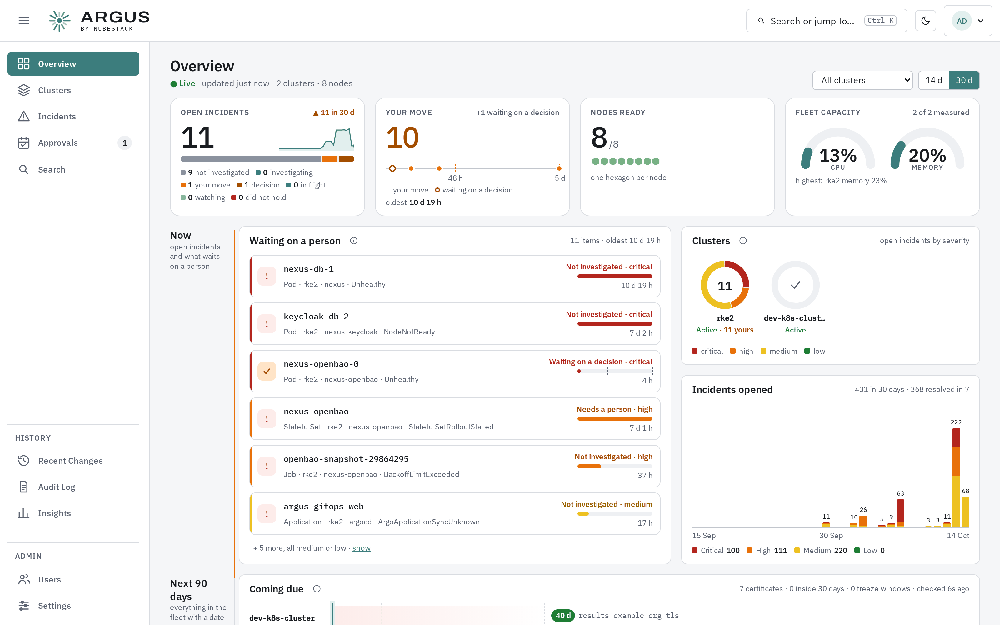

<svg class="argus-hero-mark" viewBox="4 4 56 56" role="img" aria-label="ARGUS">
  <g fill="currentColor">
    <rect x="29.6" y="4" width="4.8" height="19" rx="2.4" transform="rotate(0 32 32)"/>
    <rect x="29.6" y="4" width="4.8" height="19" rx="2.4" transform="rotate(30 32 32)"/>
    <rect x="29.6" y="4" width="4.8" height="19" rx="2.4" transform="rotate(60 32 32)"/>
    <rect x="29.6" y="4" width="4.8" height="19" rx="2.4" transform="rotate(120 32 32)"/>
    <rect x="29.6" y="4" width="4.8" height="19" rx="2.4" transform="rotate(150 32 32)"/>
    <rect x="29.6" y="4" width="4.8" height="19" rx="2.4" transform="rotate(180 32 32)"/>
    <rect x="29.6" y="4" width="4.8" height="19" rx="2.4" transform="rotate(240 32 32)"/>
    <rect x="29.6" y="4" width="4.8" height="19" rx="2.4" transform="rotate(270 32 32)"/>
    <rect x="29.6" y="4" width="4.8" height="19" rx="2.4" transform="rotate(300 32 32)"/>
    <g class="argus-mark-sleep" opacity="0.26">
      <rect x="29.6" y="13.5" width="4.8" height="9.5" rx="2.4" transform="rotate(90 32 32)"/>
      <rect x="29.6" y="13.5" width="4.8" height="9.5" rx="2.4" transform="rotate(210 32 32)"/>
      <rect x="29.6" y="13.5" width="4.8" height="9.5" rx="2.4" transform="rotate(330 32 32)"/>
    </g>
    <circle cx="32" cy="32" r="6.6"/>
  </g>
</svg>
<a href="https://nubestack.com/">NubeStack</a> / ARGUS

# ARGUS documentation

Install ARGUS on your own infrastructure, connect your Kubernetes clusters, and follow
incidents from detection to a reviewed fix.

[Install the hub](getting-started/install.md){ .md-button .md-button--primary }
[Explore ARGUS](overview/what-is-argus.md){ .md-button }

<button class="argus-search" type="button" data-argus-search aria-label="Search the documentation">
  <svg viewBox="0 0 24 24" aria-hidden="true"><path d="M9.5 3A6.5 6.5 0 1 0 13.7 14.5L19.2 20 20.6 18.6 15.1 13.1A6.5 6.5 0 0 0 9.5 3m0 2a4.5 4.5 0 1 1 0 9 4.5 4.5 0 0 1 0-9"/></svg>
  Search installation, clusters, incidents…
  <kbd>/</kbd>
</button>

Getting started

## Your first installation

1. [Install the hub](getting-started/install.md)
2. [Sign in and change the password](getting-started/first-sign-in.md)
3. [Connect an AI provider](getting-started/configure-analysis.md)
4. [Connect your other clusters](getting-started/connect-a-cluster.md)
5. [Read your first incident](getting-started/first-incident.md)

The hub starts watching its own cluster automatically.

## Guides by task

-   :material-download-outline:{ .lg .middle } [Installation and upgrades](getting-started/index.md)

    Requirements, Helm installation, first sign-in and upgrades.

-   :material-view-dashboard-outline:{ .lg .middle } [Your Kubernetes fleet](fleet/index.md)

    Cluster health, workload maps, GitOps, Helm and readiness checks.

-   :material-file-search-outline:{ .lg .middle } [Incident investigation](incidents/index.md)

    Detection, evidence, investigation and the incident lifecycle.

-   :material-source-pull:{ .lg .middle } [Reviewed fixes](remediation/index.md)

    Approvals, pull requests, in-place changes and validation.

-   :material-tune-variant:{ .lg .middle } [Administration](administration/index.md)

    Users, AI providers, single sign-on, retention and the audit log.

-   :material-shield-check-outline:{ .lg .middle } [Security and access](overview/security-model.md)

    Permissions, trust boundaries and the data that leaves a cluster.

Inside the console

## From fleet health to incident evidence

Start with the fleet overview, open an affected cluster, and read the evidence behind
an incident before reviewing its proposed fix.

Detection and investigation are read-only. Remediation is off by default.

[Explore the fleet overview](fleet/overview.md)

[Read an incident](incidents/reading-an-incident.md)

<figure class="argus-tour__shot" markdown>

{ loading=lazy }

<figcaption>The fleet overview brings cluster health and open incidents together.</figcaption>

</figure>

## See also

- [Architecture](overview/architecture.md)
- [Automation and guardrails](automation/index.md)
- [Network requirements](reference/network-requirements.md)
- [Troubleshooting](troubleshooting.md)
